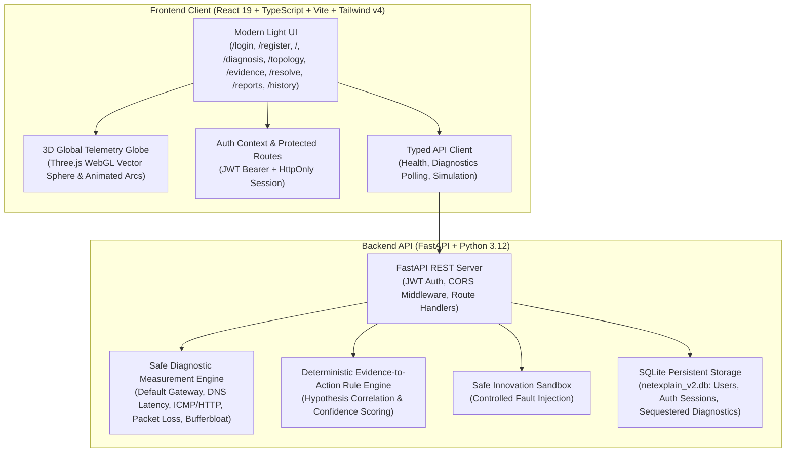

## 🌐 Live Demo
* **Frontend (Vercel):** [https://netexplain-frontend.vercel.app](https://netexplain-frontend.vercel.app)
* **Backend API (Render):** [https://netexplain-backend.onrender.com](https://netexplain-backend.onrender.com)
* **API Documentation:** [https://netexplain-backend.onrender.com/docs](https://netexplain-backend.onrender.com/docs)


# NetExplain — Measure. Explain. Resolve.

> **AIORI Hackathon 3 · Smart Cities · Problem Statement PS-015**  
> An explainable home and last-mile connectivity diagnosis platform that isolates why connections feel sluggish, choppy, or unreliable.

---

## 🌐 Product Mission & Architecture

Traditional speed tests report maximum burst download/upload figures under artificial CDN conditions. They fail to explain *why* video calls stutter, cloud applications disconnect, or latency spikes during normal household usage.

**NetExplain** bridges this gap by combining real bounded host-level network probes, deterministic multi-hypothesis inference, enterprise JWT authentication with strict tenant data sequestration, and an interactive 3D Global Telemetry Globe.

### Architecture Overview



---

## 🔒 Enterprise Authentication & Data Sequestration

NetExplain enforces strict multi-tenant isolation and security:
- **NIST-Grade Password Security**: Secure password hashing using `passlib` with PBKDF2-HMAC-SHA256 and bcrypt schemes.
- **Cryptographic JWT Tokens**: Signed JSON Web Tokens (`HS256`) with 7-day expiration, returned on `/api/auth/register` and `/api/auth/login`.
- **Protected Routes**: React Router guards enforce authentication before accessing the dashboard, live diagnosis, network path, or historical records.
- **Tenant Data Sequestration**: Database queries filter diagnostic history strictly by authenticated `user_id`. Users can only view and manage *their own* diagnostic audits.
- **Judge Quick-Access**: Built-in 1-click credential auto-fill buttons for rapid hackathon evaluation.

---

## 🌍 The "Wow" Factor: Global Telemetry Globe

Integrated directly into the Overview Dashboard and Network Topology pages:
- **Idle State**: Smooth auto-rotating vector sphere styled to NetExplain's premium light palette (soft atmospheric glow, latitude/longitude coordinate rings, procedural landmass matrix).
- **Diagnosis State**: Dynamic illuminated telemetry arcs dynamically project from the user's client node to:
  - **Local Default Gateway** (Physical LAN / Wi-Fi Hop)
  - **DNS Resolver** (System Regional Edge)
  - **Public Transit Core** (Cloudflare / Public ICMP Edge)
  - **HTTP Verification Edge** (Google Gstatic Web 204 Edge)
- **Live Color Coding**:
  - 🔵 **Blue Pulse** (`#0284c7`): Probe currently in-flight / testing.
  - 🟢 **Emerald Beam** (`#10b981`): Test completed healthy (low latency, 0% loss).
  - 🔴 **Crimson Beam** (`#ef4444`): Link failure / high packet drop.
  - 🟡 **Amber Beam** (`#f59e0b`): Warning / latency spike under mild load (bufferbloat).
- **Zero External Asset Vulnerabilities**: Runs entirely in WebGL with procedural geometry—will never break or fail to load if offline during hackathon venue presentations.

---

## 🔬 Scientific Caution & Methodology

NetExplain enforces strict diagnostic principles:
1. **Never fabricate measurements**: Unmeasured or unavailable metrics return `null` and are clearly labeled *"Not measured yet"*. Null values **never** display as 0ms or 0%.
2. **Deterministic Evidence Engine**: Technical root causes are deduced through transparent, unit-tested rule correlation—never hallucinated by generative models.
3. **Physical vs. Logical Distinction**: Distinguishes physical network hops from logical application directory services (DNS).
4. **Fail-Safe Public Ping Rule**: A dropped ICMP ping to a public server does **not** prove the internet is down if HTTP/HTTPS web probes succeed. It proves upstream ICMP filtering.
5. **Scientific Modesty**: Strictly avoids claiming Wi-Fi RF interference without dedicated physical RF telemetry.

---

## 🧭 Functional Application Modules

| Route | View | Status | Capability |
| :--- | :--- | :--- | :--- |
| `/login` | **Enterprise Login** | **Ready** | JWT authentication with Judge Quick-Fill demo access. |
| `/register` | **Account Registration** | **Ready** | Self-serve user registration with passlib hashing. |
| `/` | **Overview Dashboard** | **Ready** | Global 3D Telemetry Globe, connection verdict, 5 real metrics, path map, and quick action. |
| `/diagnosis` | **Guided Live Diagnosis** | **Ready** | Bounded measurement runner with live status polling, progress bar, localized completion timestamp, and cancel button. |
| `/topology` | **Network Path** | **Ready** | 3D Geospatial telemetry globe, hop-by-hop topology mapping, and physical vs. logical annotations. |
| `/evidence` | **Evidence Explorer** | **Ready** | Deep-dive inference audit: observed facts, hypothesis evaluation (supported vs contradicted), and confidence scores. |
| `/resolve` | **Resolution Playbooks** | **Ready** | Actionable remediation playbooks, SQM/Cake bufferbloat configuration, and DNS fallback guidance. |
| `/reports` | **ISP Evidence Ticket** | **Ready** | Exportable diagnostic dossier proving LAN health and documenting ISP degradation. |
| `/history` | **Diagnostic History** | **Ready** | Sequestered SQLite audit log with severity filtering, live vs simulated toggle, and purge capability. |
| `/simulation` | **Simulation Sandbox** | **Ready** | Controlled fault injection lab evaluating edge-case failures through the deterministic rule engine. |
| `/settings` | **Agent Settings** | **Ready** | Measurement engine capability matrix and customizable probe targets. |

---

## 🚀 Quick Start Guide

### Prerequisites
- **Python**: 3.11 or 3.12 (Python 3.12.10 verified)
- **Node.js**: v20 or higher (v24 LTS verified)
- **NPM**: v10 or higher

---

### Windows (PowerShell)

#### Terminal 1 — Backend API
```powershell
# 1. Navigate to backend directory
cd backend

# 2. Activate Python virtual environment
.\.venv\Scripts\Activate.ps1

# 3. Run backend unit test suite
pytest -v

# 4. Start FastAPI server
uvicorn app:app --host 127.0.0.1 --port 8000 --reload
```
*Backend runs at: `http://127.0.0.1:8000` (Swagger UI: `http://127.0.0.1:8000/docs`)*

#### Terminal 2 — Frontend Application
```powershell
# 1. Navigate to frontend directory
cd frontend

# 2. Verify TypeScript build
npm run build

# 3. Start Vite development server
npm run dev
```
*Frontend runs at: `http://localhost:5173`*

---

### Linux / macOS (Bash / Zsh)

#### Terminal 1 — Backend API
```bash
cd backend
python3 -m venv .venv
source .venv/bin/activate
pip install -r requirements.txt
pytest -v
uvicorn app:app --host 127.0.0.1 --port 8000 --reload
```

#### Terminal 2 — Frontend Application
```bash
cd frontend
npm install
npm run build
npm run dev
```

---

## ⏱️ 3-Minute Hackathon Demonstration Script

Follow this sequence to demonstrate all platform capabilities to hackathon judges:

### 1. Enterprise User Login (30 seconds)
1. Open `http://localhost:5173`.
2. Notice the Protected Route intercepts unauthenticated visitors and displays the `/login` screen.
3. Click **Fill: Lead Judge** under *Hackathon Judge Quick-Access*.
4. Click **Sign In**.
5. Observe the header: The user initials badge (`JU`) appears, and the status shows **API v0.2.0 · Engine Ready**.

### 2. Baseline Live Measurement & Telemetry Globe (45 seconds)
1. On the Overview page, observe the **Global Telemetry Propagation Globe** rotating smoothly in idle mode.
2. Click **Start Diagnosis** (navigates to `/diagnosis`).
3. Click **Start Full Diagnosis**.
4. Watch the progress bar increment from 0% to 100% as tests execute in real time:
   - Gateway reachability, DNS lookup timing, external ICMP, external HTTP 204, packet loss burst, and mild-load bufferbloat delta.
5. Point out the **Localized Completion Timestamp** appearing in the header upon test completion.
6. Return to `/` or navigate to `/topology` to observe the **3D Telemetry Globe** illuminated with emerald-green telemetry arcs connecting the client host to healthy infrastructure targets.

### 3. Controlled Fault Simulation (30 seconds)
1. Click **Simulation** in the sidebar (`/simulation`).
2. Select **Upstream ISP Broadband Outage** or **Last-Mile Bufferbloat Saturation**.
3. Click **Execute Simulation**.
4. Point out the prominent **[SIMULATED RESULT]** badge, proving controlled sandbox isolation.
5. Notice the deterministic inference engine correctly isolates the injected failure without hallucination.

### 4. Deterministic Evidence Explorer (30 seconds)
1. Click **Evidence** in the sidebar (`/evidence`).
2. Show the judges the transparent **Confidence Rating** (e.g. *High 85%* with mathematical rationale).
3. Walk through the **Hypotheses Table**:
   - Show how the rule engine explicitly marks hypotheses as **Supported** (e.g. *Bufferbloat Queue Delay*) vs. **Contradicted** (e.g. *Upstream Outage*).
   - Point out that dropped public pings with intact HTTP traffic are recognized as ICMP filtering, **not** an internet outage.

### 5. Resolution Playbooks & Dossier Export (45 seconds)
1. Click **Resolution** (`/resolve`) to show step-by-step guidance tailored to the diagnosis.
2. Click **ISP Reports** (`/reports`) to show the formal printable diagnostic dossier with client IP, gateway IP, and measured RTT table.
3. Click **Export JSON** to demonstrate machine-readable evidence export for ISP escalation.
4. Click **History** (`/history`) to confirm the session was safely logged to SQLite, strictly sequestered to the current user.

---

## 🧪 Test Suite Verification

### Backend Pytest Suite
```powershell
Set-Location backend; .\.venv\Scripts\pytest.exe -v
```
```
collected 18 items
backend/test_app.py::test_root_endpoint PASSED                           [  5%]
backend/test_app.py::test_health_endpoint PASSED                         [ 11%]
backend/test_app.py::test_agent_status_endpoint PASSED                   [ 16%]
backend/test_app.py::test_passlib_and_jwt_auth_workflow PASSED           [ 22%]
backend/test_app.py::test_data_sequestration_multi_tenant PASSED         [ 27%]
backend/test_app.py::test_controlled_simulation_scenarios PASSED         [ 33%]
backend/test_app.py::test_session_cancellation PASSED                    [ 38%]
backend/test_diagnostic_engine.py::test_parse_ping_output_windows PASSED [ 44%]
backend/test_diagnostic_engine.py::test_parse_ping_output_linux PASSED   [ 50%]
backend/test_diagnostic_engine.py::test_run_gateway_test_healthy PASSED  [ 55%]
backend/test_diagnostic_engine.py::test_run_gateway_test_unreachable PASSED [ 61%]
backend/test_diagnostic_engine.py::test_run_dns_test_success PASSED      [ 66%]
backend/test_diagnostic_engine.py::test_run_packet_loss_test_warning PASSED [ 72%]
backend/test_diagnostic_engine.py::test_rule_engine_all_healthy PASSED   [ 77%]
backend/test_diagnostic_engine.py::test_rule_engine_local_gateway_down PASSED [ 83%]
backend/test_diagnostic_engine.py::test_rule_engine_upstream_isp_down PASSED [ 88%]
backend/test_diagnostic_engine.py::test_rule_engine_bufferbloat_detected PASSED [ 94%]
backend/test_diagnostic_engine.py::test_rule_engine_failed_public_ping_does_not_claim_internet_down PASSED [100%]
============================= 18 passed in 1.99s ==============================
```

### Frontend TypeScript & Vite Production Build
```powershell
Set-Location frontend; npm run build
```
```
✓ 1621 modules transformed.
dist/index.html                   1.24 kB │ gzip:   0.69 kB
dist/assets/index-Bbaw6eeY.css   43.92 kB │ gzip:   7.96 kB
dist/assets/index-CjySfnLU.js   941.83 kB │ gzip: 247.67 kB
✓ built in 12.96s
```
